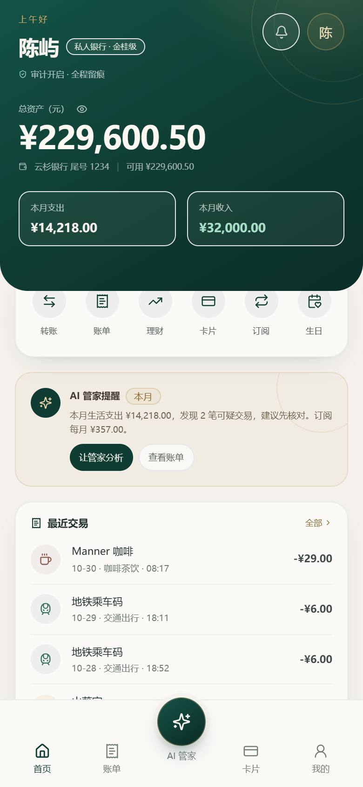
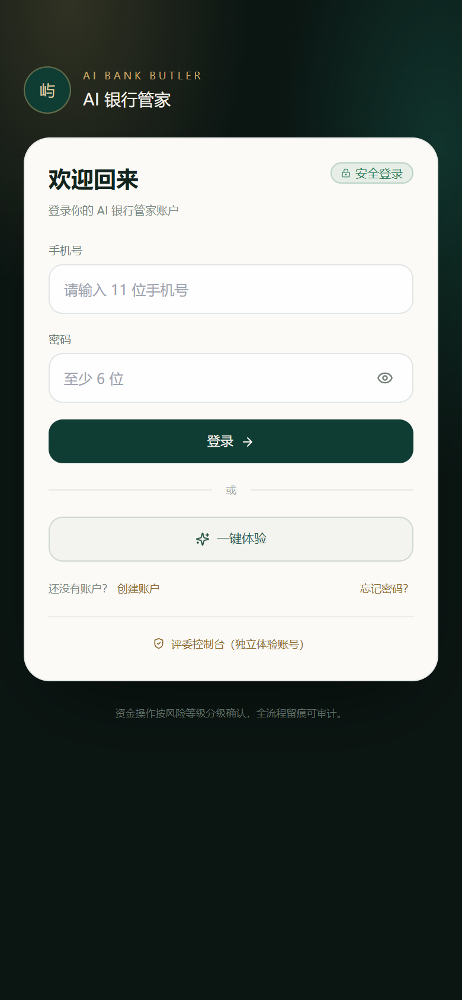
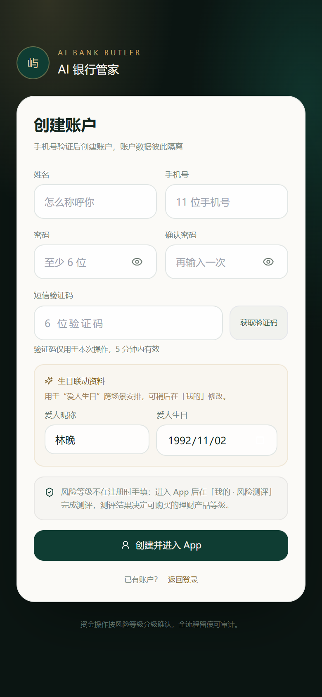
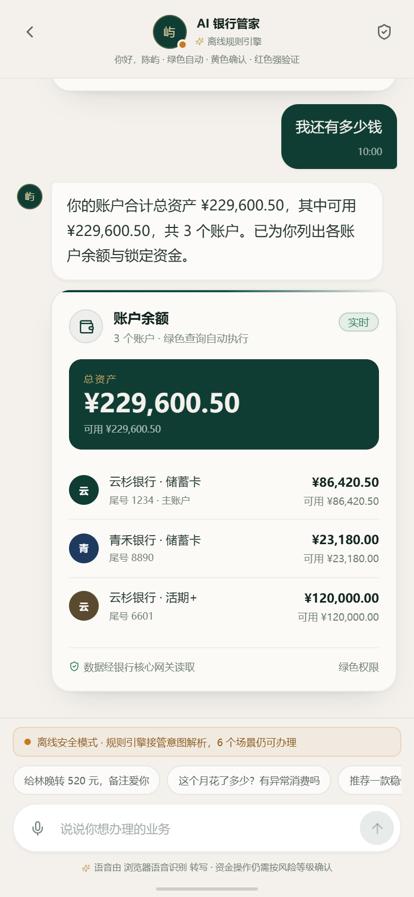
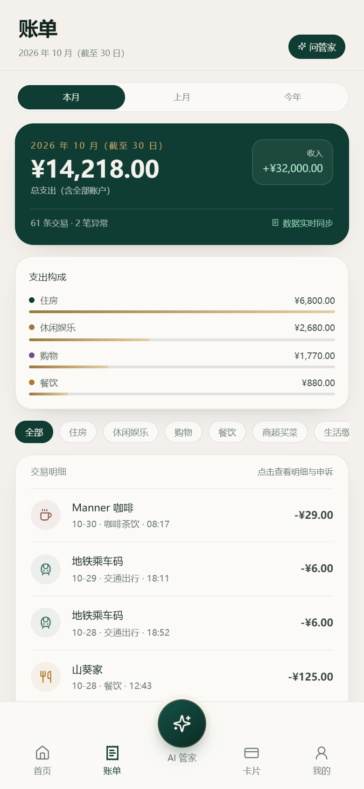
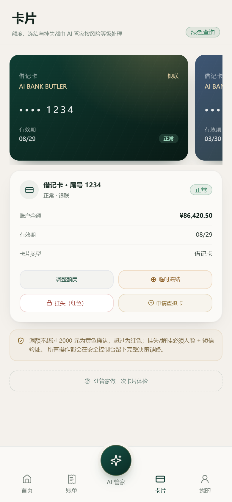
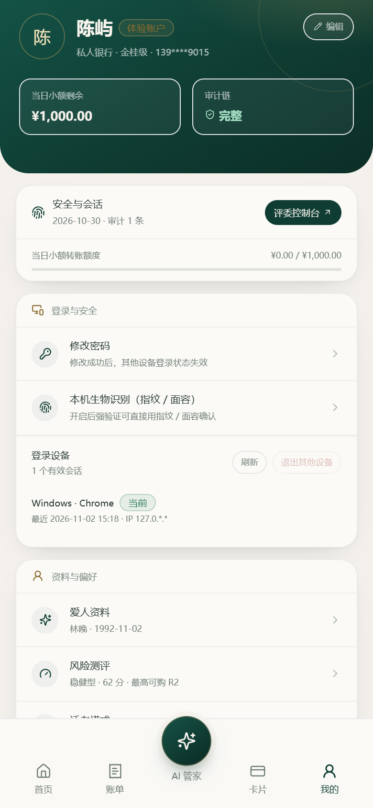
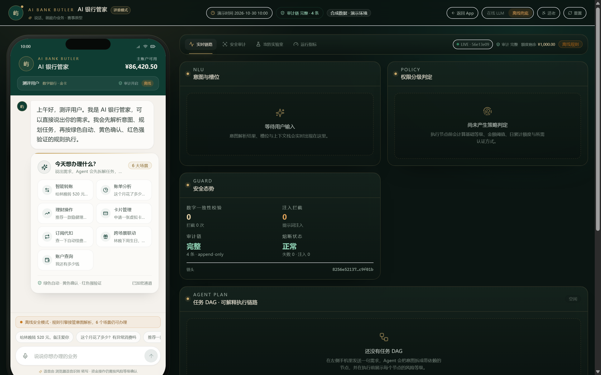

# AI 银行管家

> 一个真正能登录、能安装、能公网访问的银行 AI 智能体产品原型。
> 绿色自动 · 黄色确认 · 红色强验证 · 一次性授权 · 全链路审计
> 内置可切换的签名银行核心接入层与真实短信 / 人脸核验 Provider，默认使用合成数据演示。



## 作品简介（≤200 字，可直接提交）

我们构建了一个“说话就能办业务”的银行 AI 智能体：基于大模型意图解析与 Agent DAG 编排，自动拆解并安全执行转账、账单、理财、卡片、订阅与生日联动。产品支持手机号注册登录、独立数据空间与可安装 PWA；以绿色自动、黄色确认、红色强验证为骨架，配合一次性操作授权、注入防御、数字一致性守卫、哈希链审计与受限沙箱，所有回执由工具结果渲染，兼顾体验、安全与可解释性。

## 产品形态

- **手机 PWA**：登录 / 注册 / 一键体验，手机全屏使用，可“添加到主屏幕”，支持离线启动外壳、独立窗口运行。
- **多用户数据空间**：每个账号拥有独立的合成账户、6 个月流水、卡片、订阅、理财持仓、额度与安全状态；会话与审计严格按用户隔离。
- **AI 管家**：自然语言办理 6 个场景，复杂任务拆成 DAG，按风险等级自动执行 / 确认 / 人脸 + 短信强验证。
- **评委控制台 `/console`**：登录后从「我的 → 评委控制台」进入，实时查看意图、DAG、权限判定、审计链、攻击实验室、沙箱和 LLM 成本；与产品端共享同一账号数据，但使用独立演示会话。

作品名 **AI 银行管家**，拉丁字标 `AI BANK BUTLER`，集中在 `packages/shared/src/brand.ts` 一处维护。

## 截图

| 登录 / 一键体验 | 创建账户 |
| --- | --- |
|  |  |

| AI 管家对话 | 账单分析 |
| --- | --- |
|  |  |

| 卡片与额度 | 我的 / 安全与安装 |
| --- | --- |
|  |  |

| 评委控制台 |
| --- |
|  |

## 六个场景

| 场景 | 可演示能力 |
| --- | --- |
| 智能转账 | 按人名 / 手机号 / 备注转账、同名联系人澄清、定时转账、AA 收款、当日冲正 |
| 账单分析 | 月 / 年账单、分类聚合、异常交易、重复扣费、上期对比、沙箱消费洞察 |
| 理财操作 | 风险测评读取、产品匹配对比、一键申购 / 赎回、持仓与收益展示 |
| 卡片管理 | 卡片与额度总览、虚拟卡申请、调额、冻结 / 解冻、挂失 |
| 订阅代扣 | 自动续费识别、涨价提醒、重复扣费检测、一键取消、可恢复 |
| 跨场景联动 | “我爱人生日”→ 锁定活期预算、预约鲜花 / 蛋糕、写入日程，一次对话完成 |

## 安全设计（摘录）

- **权限执行层**：绿色查询自动执行；黄色操作展示详情 + 明确确认后签发 90 秒一次性 `PolicyGrant`；红色操作需人脸，单笔 > 5000 元或挂失 / 解挂再加短信。默认演示码 `246810`、页面人脸动画；配置 HTTP Provider 后，人脸通过结果以合作方服务端为准。1000 元是黄色 / 红色分界，不是金额上限。
- **幻觉防护**：LLM 只输出意图和槽位；余额、流水、回执全部由工具结果模板渲染；渲染后再做数字一致性守卫，证据外的金额 / 百分比会被拦截并回退模板。
- **注入防御**：输入特征 + 模型嫌疑 + 服务端工具白名单 / 策略 / 授权 / 额度台账三层独立；控制台可现场发攻击、跑自检。
- **审计**：追加式哈希链，记录意图、规划、策略、确认、授权、工具结果、补偿、熔断；每 50 条 checkpoint；控制台支持整链校验、副本篡改演示和按 run 回放。审计条目按用户隔离。
- **异常熔断**：连续 3 次工具失败或 2 次注入命中锁定 10 分钟，人工复核解锁。
- **沙箱**：worker_threads + vm，无 fs / net / require，2.2 秒硬超时；静态检查拒绝越界调用。
- **账号安全**：scrypt 密码哈希；HttpOnly + SameSite=Lax + Secure（公网）签名 Cookie；登录 / 注册 / 游客限流；所有会话、会话访问、审计回放都校验账号归属；前端不接触 API Key。

详细设计见 [架构与核心算法](docs/architecture.md)、[安全自评报告](docs/security-self-assessment.md) 与 [API 契约](docs/api.md)。

## 真实接入能力（不止是模拟）

默认 `BANKING_MODE=simulated`，保证比赛现场零外部依赖。把接入模式切到 `http` 后，账户、流水、卡片、订阅、持仓与全部资金操作都会走服务端的 **银行核心接入网关**：

- **统一契约**：`GET /v1/snapshot` 拉取真实数据；`POST /v1/ops` 执行转账、冲正、理财申赎、卡片、订阅、定时、资金锁定、礼物与 AA。
- **安全边界**：HMAC-SHA256 请求签名、5 分钟时间窗、nonce 防重放、写操作幂等键、超时 / 重试 / 客户端熔断；失败显式报错，**绝不静默回退合成数据**。
- **快照校验**：上游报文经 Zod 严格校验后才落盘；账户、卡、流水以银行返回为准，用户资料与联系人仍留在本地身份域。
- **真实核验**：`SMS_MODE=http` 走签约短信 / 核验服务，不再使用固定码；`FACE_MODE=http` 创建活体会话并轮询服务端结果，页面点击不能伪造“已通过”。
- **联调与回归**：仓库提供契约联调桩，`npm run smoke:full` 会让六大场景、强验证、回退与审计全部经过 HTTP 适配层和短信 / 人脸 Provider。

```bash
# 一条命令验证“真实接入路径”完整跑通（使用本地契约桩，不连接真实银行）
npm run smoke:full
```

接入步骤、签名算法、操作清单、错误码、Provider 契约与上线清单见 [银行核心接入说明](docs/banking-integration.md) 和 [OpenAPI 契约](docs/openapi-banking.yaml)。仓库不包含真实银行密钥；正式接入需行方完成客户绑定、准入、mTLS 与联调。

## 快速开始

环境：Node.js 24（≥ 20.19 亦可）、npm 11。Windows / macOS / Linux 可用，无 Docker、无原生依赖。

```bash
npm install

# 可选：复制环境变量模板，填入 DeepSeek 兼容 Key
cp .env.example .env

npm run dev
```

- 产品端：http://localhost:5173
- API：http://localhost:8787/api/health
- 评委控制台：登录后访问 http://localhost:5173/console

没有 Key 也能跑：系统自动使用规则引擎；也可以在「我的 → 离线兜底」或控制台顶部切换。

### 演示路径

1. 打开产品端 → 点「一键体验」生成独立演示账户（或注册自己的账户）。
2. 首页 → 点「AI 管家」，说：`给林晚转 520 元，备注爱你` → 黄色确认 → 回执。
3. 继续说：`再给林晚转 6000 元` → 红色强验证 → 演示码 `246810`。
4. 说：`这个月花了多少？有异常消费吗` → 账单、异常与沙箱洞察。
5. 说：`我爱人下周生日，帮我提前安排` → 一次确认 3 个操作。
6. 去「我的 → 评委控制台」查看实时 DAG、权限理由、审计链，运行攻击实验室和安全自检。

### 环境变量

| 变量 | 默认 | 说明 |
| --- | --- | --- |
| `PORT` | `8787` | 服务端端口 |
| `DEMO_NOW` | `2026-10-30T10:00:00+08:00` | 演示时钟（只影响业务日期） |
| `BUSINESS_CLOCK` | 自动 | `demo` 用演示时钟；`real` 用真实时间。未设置时 simulated→demo，http→real |
| `LLM_BASE_URL` | — | OpenAI 兼容地址，如 `https://api.deepseek.com` |
| `LLM_API_KEY` | — | 仅服务端读取，绝不进入前端或仓库 |
| `LLM_MODEL` | `deepseek-chat` | 模型名 |
| `LLM_OFFLINE` | `0` | `1` = 启动即离线规则引擎 |
| `LLM_DAILY_LIMIT` | `500` | 公网演示全局日调用上限；超限自动规则兜底 |
| `COOKIE_SECURE` | `0` | 公网 HTTPS 演示必须设为 `1` |
| `AUTH_SECRET` | 自动生成 | 至少 32 字节；不设则写入 `DATA_DIR/runtime/auth-secret` |
| `DATA_DIR` | `./data` | 多用户状态、审计、密钥目录 |
| `DEMO_NODE_DELAY_MS` | `220` | DAG 节点停留时间，便于观察与中断 |
| `BANKING_MODE` | `simulated` | `http` 时经签名网关读写真实银行核心，失败不回退仿真 |
| `SMS_MODE` / `FACE_MODE` | `demo` | `http` 时接签约短信 / 活体核验服务 |
| `BANKING_*` / `SMS_*` / `FACE_*` | — | 地址与 HMAC 凭据；见[接入说明](docs/banking-integration.md) |

### 生产构建与公网演示

```bash
npm run build
DATA_DIR="$PWD/data-public" PORT=8788 COOKIE_SECURE=1 npm start
```

然后用任意 HTTPS 隧道把 `8788` 暴露到公网。Cloudflare Quick Tunnel（免费、无需账号）：

```bash
# tools/ 不入库；先下载 cloudflared，再运行
tools/cloudflared.exe tunnel --url http://127.0.0.1:8788 --protocol http2 --no-autoupdate
# 或在 macOS / Linux 安装 cloudflared 后：
# cloudflared tunnel --url http://127.0.0.1:8788 --protocol http2
```

公网链接为 HTTPS 后，手机浏览器即可“添加到主屏幕”。当前演示使用的是临时隧道，链接随进程与隧道生命周期变化；稳定上线请参考 [部署说明](docs/deploy.md) 的 Docker / Render 方案。

## 常用脚本

| 命令 | 作用 |
| --- | --- |
| `npm run dev` | 同时启动 API（tsx watch）与 Vite |
| `npm run build` | 构建前端到 `apps/web/dist` |
| `npm start` | 启动 API 并托管已构建前端 |
| `npm test` | Vitest 单元测试（87 个） |
| `npm run smoke` | 独立临时服务（离线模式）：注册 / 访客 / 多用户隔离 / 6 场景 / 强验证 / 回退 / 熔断 / 审计 |
| `npm run smoke:bank` | 同上，但服务端 `BANKING_MODE=http`，经签名适配层访问契约桩 |
| `npm run smoke:full` | 银行核心 + 短信 + 人脸都走 HTTP Provider 的完整接入回归 |
| `npm run bank:stub` | 启动本地银行核心 / 核验契约桩（8791，仅联调） |
| `npm run e2e` | 对已启动服务跑真实 LLM 演示链路（会自动创建独立访客） |
| `npm run reset` | 重置当前演示数据；后端未启动时删除运行时文件 |

## 架构

```mermaid
flowchart LR
  U[手机 PWA / IM 渠道] --> AUTH[账号登录<br/>签名 Cookie]
  AUTH --> APP[产品端：首页 / 对话 / 账单 / 卡片 / 我的]
  APP -->|POST /api/chat · SSE| API[Fastify API]
  CONSOLE[/console 评委模式] <--> API
  API --> N[意图解析<br/>DeepSeek + 缓存 + 规则]
  N --> P[DAG 规划]
  P --> E[拓扑执行]
  E --> POL[权限引擎]
  POL --> G[一次性授权 / 强验证]
  G --> T[工具注册表 / 银行核心网关<br/>simulated · http]
  E --> S[worker + vm 沙箱]
  T --> BC[签名银行核心 / 短信 / 人脸]
  E --> AUDIT[按用户隔离的审计链]
  API --> STORE[(多用户 JSON 状态<br/>可替换为 Postgres)]
```

- [系统架构与核心算法](docs/architecture.md)
- [API 与 SSE 契约](docs/api.md)
- [安全自评报告（含已知风险清单）](docs/security-self-assessment.md)
- [银行核心 / 短信 / 人脸接入说明](docs/banking-integration.md)
- [5 分钟演示脚本 + 10 分钟答辩提纲](docs/demo-script.md)
- [部署说明](docs/deploy.md)
- [功能实现核查报告（含仍未真实化的边界）](docs/feature-audit.md)
- [独立产品巡检报告（问题与修复）](docs/product-review.md)
- [200 字作品简介](docs/submission-intro.md)

## 测试与验收

- 87 个 Vitest 单元测试：权限边界、并发额度、grant 篡改 / 重放 / 过期、审计哈希链、注入、规则解析、DAG 规划、台账、HTTP 签名 / 幂等重试 / 熔断与快照校验。
- `npm run smoke`：独立临时服务，覆盖访客登录、注册 / 登录、跨用户会话隔离、六场景、批量确认、回退、双因子、熔断、中断、接管、审计；包含理财申购 / 赎回实际执行。
- `npm run smoke:bank` / `smoke:full`：同一套六场景用例经 HTTP 银行核心适配层执行；full 模式下短信与人脸也走 HTTP Provider。
- `npm run e2e`：真实 DeepSeek 链路 8 场景 + 注入拦截 + 110+ 条审计校验通过。
- 公网验收：HTTPS 页面、manifest（0 errors）、Service Worker 注册、登录、首页、聊天 SSE 均已验证。

## 已知边界

- 默认仍使用本地合成核心、演示短信码与页面人脸动画；真实接入需配置 `BANKING_MODE=http` / `SMS_MODE=http` / `FACE_MODE=http` 并完成行方准入。仓库不含真实密钥，也尚未实现客户绑定、异步对账和 mTLS 终止。
- 多用户状态使用单机 JSON 文件，适合原型与单实例演示；生产需 Postgres/Redis、分布式锁与字段加密。
- 登录暂无手机号验证、找回密码、登录 MFA、设备绑定与账号注销；公网演示存在访客滥用与 LLM 成本暴露风险，需生产化补齐。
- 临时公网隧道依赖当前机器运行；稳定链接请使用 Docker + 长期托管。
- 完整风险清单见 [安全自评报告](docs/security-self-assessment.md)；本原型不构成合规或投资建议。

## 目录

```
apps/server        Fastify API、账号认证、Agent 运行时、策略/审计/沙箱、六场景工具
apps/web           产品端 PWA（登录 / 首页 / 对话 / 账单 / 卡片 / 我的）、评委控制台、设计系统
packages/shared    类型、风险常量、品牌占位、格式化、SSE 契约
scripts            smoke / e2e / 重置 / PWA 图标生成
docs               架构、API、安全自评、演示脚本、部署、截图
data               本地开发运行时状态与审计（gitignored）
```

> 默认演示模式：全部账户、流水、联系人、持仓均为合成数据，不连接真实机构。配置接入模式后，页面与健康检查会显示实际数据源与核验通道。
