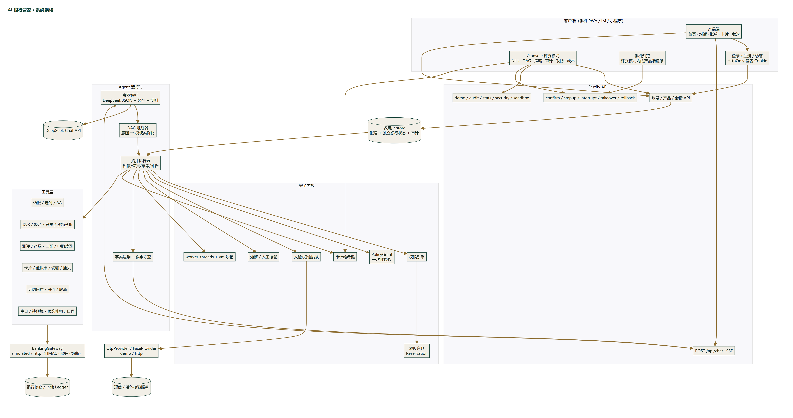
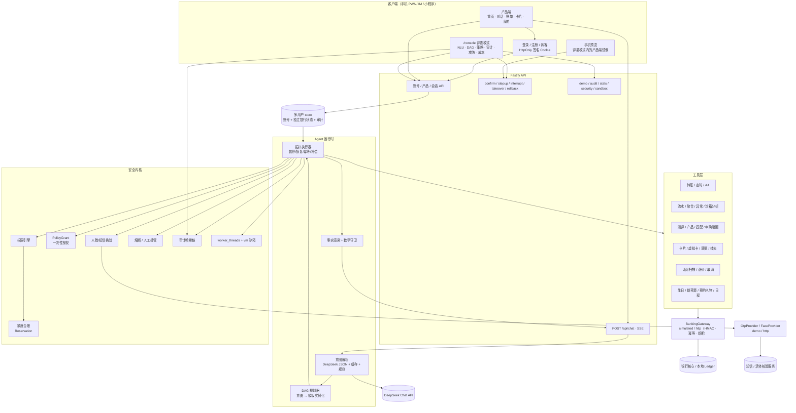
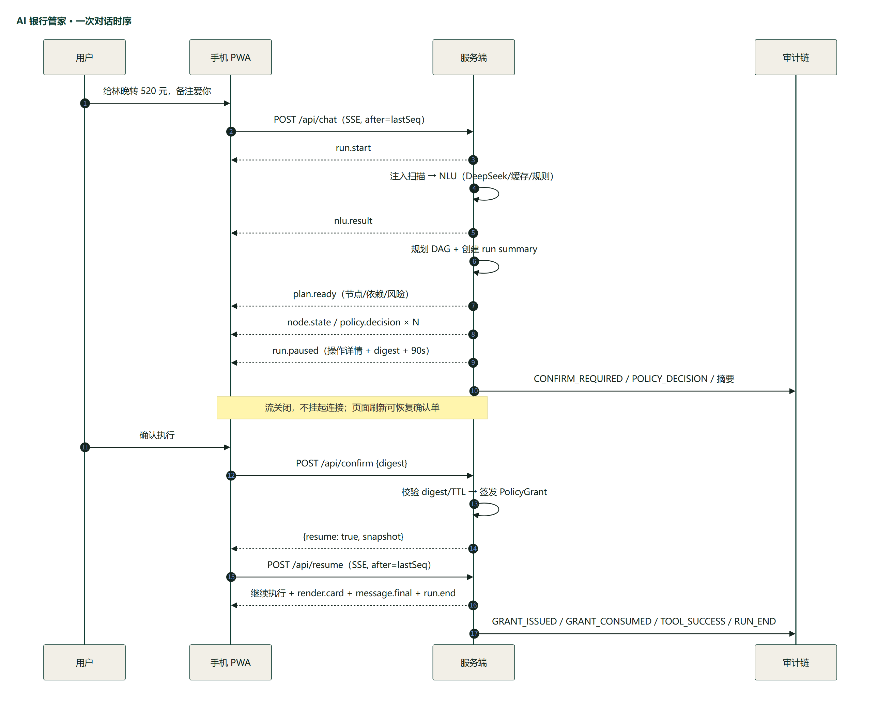
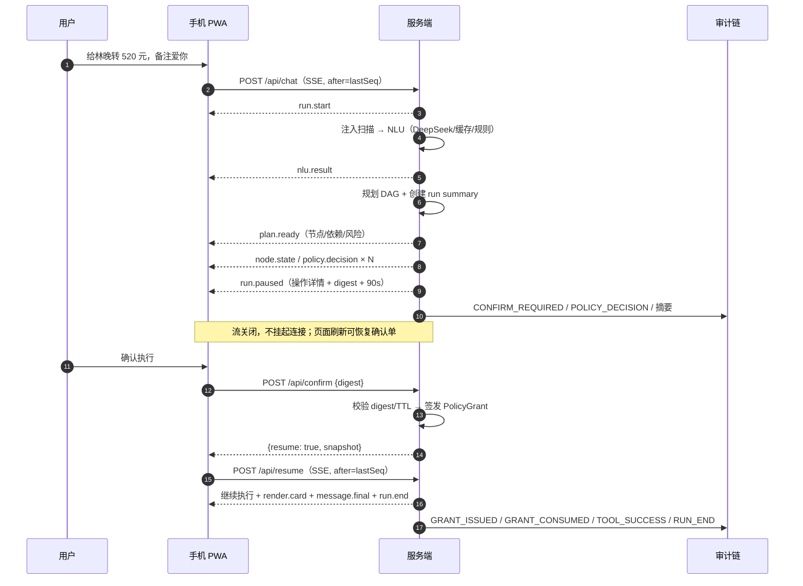

# 系统架构与核心算法

## 1. 设计原则

1. **模型只做理解，不碰执行**：LLM 输出受 zod 约束的意图与槽位；工具选择、金额校验、风险分级、授权签发全部在服务端确定性代码中完成。
2. **事实只能来自工具**：所有面向用户的余额、流水、收益、回执由模板绑定工具结果渲染，LLM 不生成事实数字。
3. **安全边界在服务端**：提示词注入、伪造身份、改单、重放都不能绕过工具白名单、`PolicyGrant` 与额度台账。
4. **每一步可解释、可审计、可回放**：意图、规划、策略、确认、验证、工具结果、补偿、熔断均写入追加式哈希链。
5. **演示稳定优先**：LLM 三级兜底（在线 → 缓存 → 规则），可注入时钟与一键重置，断网仍可完整演示。
6. **产品化隔离**：账号、银行状态、会话、额度、审计、熔断均按用户隔离；PWA 与评委控制台共享账号数据、使用独立会话。
7. **可接入而非写死**：工具只依赖 `BankingGateway`；默认本地仿真，配置 `BANKING_MODE=http` 后所有账户读写经签名网关访问银行核心，失败显式上抛，不回退仿真。短信与人脸同样有 `demo / http` 两种 Provider。

## 2. 总体架构





> 渠道说明：手机 PWA 是默认渠道；`/api/chat`、确认、强验证与审计接口与展示层解耦，可被微信/飞书/小程序等 IM 渠道复用。评委控制台需要登录态，只读取当前账号的数据。

## 3. 一次对话的完整时序





### 为什么“暂停即断流”

- SSE 不等待人工确认，**发出 `run.paused` 后主动关闭**，避免代理超时、连接泄漏。
- 确认后新开一条 SSE，`?after=<seq>` 从环形缓冲续传；每会话保留 320 条事件与单调 `seq`。
- `GET /api/session/:id` 返回完整快照（消息、DAG、pending、额度、上下文），刷新页面可恢复确认单与强验证倒计时。
- 演示时钟冻结，但确认/验证/预留使用**真实墙钟**计算 TTL，避免“演示时间 10:00、系统时间 17:00 → 一打开就过期”。

## 4. 意图解析（NLU）

### 4.1 三级链路

```
LLM 结构化输出（temperature 0, json_object, 8s, max 520 tokens, 重试 1 次）
  → zod 宽松校验 + 槽位归一化
  → 缓存（归一化语句 + 上次收款人/金额，LRU 120）
  → 规则引擎（确定性正则 + 中文金额 + 联系人/订阅/产品映射）
```

- 输入提示词包含：演示日期、用户画像、配偶生日、常用联系人（姓名/关系/银行/尾号）、上次收款人/金额、最近 4 条对话；**手机号在发送给 LLM 前脱敏**，原文抽取到的 11 位号码仍用于联系人匹配。
- 输出只允许白名单意图：`transfer / bills / wealth / card / subscription / crossscene / account / chitchat / unknown`。
- 槽位按意图做**清理**：转账不会保留产品/卡片槽位，查询不会保留 AA 槽位，减少控制台噪声和提示词污染。
- LLM 返回的金额若与原文抽取冲突，以原文抽取为准；原文没有数字信号时，金额槽位清空。
- 解析失败重试一次；仍失败降级规则引擎，并在 `nlu.result.source` 标记 `llm / cache / rules / offline`。

### 4.2 模糊与省略

- “再转 200”：`payee=null`，`references=["lastPayee"]`；规划器从上下文栈补全上次收款人。
- “给王磊转 500”：两个王磊（同事/房东）→ 返回带银行与尾号的澄清卡片；用户点选后通过 `contactId` 精确进入规划。
- “我想放一万”：识别金额 10000、动作为“推荐/对比”，不会直接申购；只有出现“申购/买入/购买”等明确动作才追加红色申购节点。
- 中文金额支持：五百、一千、一万、五万等；AA 场景解析总金额与联系人。

## 5. DAG 规划

规划器（`apps/server/src/agent/planner.ts`）只做一件事：**把意图 + 槽位实例化为固定模板**。LLM 不能自由选工具。

| 场景 | 节点与依赖 |
| --- | --- |
| 转账 | `resolve_contact → check_limit → transfer`；定时：`resolve → schedule_transfer`；AA：`resolve × N → split_request` |
| 账单 | `fetch_transactions → (aggregate_bills, detect_anomalies, sandbox_analyze)` |
| 理财 | `assess_risk → list_products → match_products`；申购/赎回再接红色节点 |
| 卡片 | `list_cards → apply_virtual / adjust_limit / freeze / unfreeze / report_loss` |
| 订阅 | `scan_subscriptions → detect_price_changes`；取消再接 `cancel_subscription` |
| 生日 | `resolve_birthday → lock_funds → (order_flower, order_cake) → create_note` |
| 账户 | `get_balance` 或 `list_transactions` |

每个节点包含：

```ts
interface DagNode {
  id: string;
  tool: ToolName;
  label: string;
  args: Record<string, unknown>;
  deps: string[];
  risk: 'GREEN' | 'YELLOW' | 'RED';  // 初始基础等级，执行时由策略引擎重算
  reversible: boolean;               // 是否具备补偿能力
  status: NodeStatus;
  result?: ToolResult;
  policy?: PolicyDecision;
  compensator?: ToolName;
}
```

### 批量黄色确认

生日联动包含 3 个黄色操作（锁预算、鲜花、蛋糕）。执行器在第一个暂停点收集**同一 run 内后续所有黄色、可确认节点**，合并为一张确认单，一次确认后为每个节点签发独立 grant；任意节点若在确认期间风险升级，会再次暂停要求强验证。

## 6. 执行器

拓扑顺序执行（按插入顺序，依赖满足才运行）：

```
while 有可执行节点:
  RUNNING → 策略判定 → (无 grant 则暂停) → 校验/消费 grant
  → 幂等检查 → [转账] 预留额度 → 执行工具 → 提交/释放额度
  → 写审计 → 下一个
```

- **幂等键**：`sha256(sessionId|runId|nodeId|tool|稳定序列化 args)`；结果写入持久化台账，重放返回原结果。
- **暂停**：节点进入 `AWAIT_CONFIRM / AWAIT_STEPUP`，写入 `pending` 与摘要；返回后 SSE 关闭。
- **恢复**：确认/强验证后签发 grant，`POST /resume` 再次进入执行器；grant 校验包含节点、摘要、TTL、一次性消费与**当前风险等级**。
- **并发安全**：额度采用预留-提交两阶段；工具与幂等写入单进程串行；跨进程生产需数据库行锁/分布式锁。
- **失败**：工具失败会记入熔断计数；依赖该节点的后续节点标记 `SKIPPED`；已成功的节点保留，run 结束为 `PARTIAL`。
- **中断**：请求在节点边界生效；未执行节点 `SKIPPED`，已完成操作保留，UI 显示“部分完成”而不是“已取消”。
- **回退**：逆拓扑执行补偿器（冲正转账、取消预约、恢复订阅、解锁资金）；不可逆操作转人工工单，绝不假装已回退。
- **人工接管**：执行器在每个节点前检查接管标记；控制台可恢复或终止；所有动作写审计。

## 7. 权限引擎与授权

### 7.1 有效风险算法

```text
effectiveRisk(tool, args, state):
  if breakerLocked: DENY
  base = tool.baseRisk
  switch tool:
    transfer:
      used = committed(day) + held(day)
      if amount > 50,000元: DENY（演示硬限额）
      risk = amount <= max(0, 1000元 - used) ? YELLOW : RED
      if amount > 5000元: risk = RED，需要人脸+短信
    purchase/redeem/report_loss/unfreeze: RED
    adjust_card_limit: amount <= 2000元 ? YELLOW : RED
    schedule/split/subscription_cancel/virtual_card/freeze/lock_funds/gift<=300元: YELLOW
    query/sandbox/render helpers: GREEN
  reasons = [AUTO_QUERY | SMALL_TRANSFER | DAILY_LIMIT_EXCEEDED | HIGH_VALUE | RED_BASE | ...]
  decision = GREEN→ALLOW, YELLOW→CONFIRM, RED→STEPUP
```

关键点：**1000 元是黄色/红色的分界线，不是硬上限**。红色大额转账经强验证后允许执行，但会占用当日累计台账，使后续请求继续走红色。

### 7.2 一次性授权

```
digest = sha256(userId | sessionId | runId | nodeId | tool | canonical(args))
grant  = {nodeId, tool, risk, amount, digest, expiresAt(90s), usedAt?}
```

- 用户确认的是 `digest`；确认后修改金额/收款人会导致执行前摘要不匹配。
- grant 绑定当前有效风险；如果确认期间额度被其他操作占用导致风险升级，旧 grant 拒绝并要求重新强验证。
- 消费是原子的：校验通过立即 `usedAt=now`；重放返回 `GRANT_ALREADY_USED`。
- 黄色批量确认：确认单摘要覆盖所有节点，但每个节点仍获得自己的 grant；执行时逐个校验。

### 7.3 强验证

- 红色默认人脸；单笔 > 5000 元、挂失/解挂额外要求短信验证码。
- demo 与 HTTP 模式都必须"先发送、再校验"：demo 下发一次性随机码（5 分钟、用后即废），HTTP 由签约短信 / 活体服务送达并由服务端确认 `passed`，客户端不能伪造。固定万能码已移除。
- 生物识别因子：录入通行密钥（WebAuthn platform，Windows Hello / Touch ID / Face ID）后，红色强验证的人脸因子可由本机生物识别签名满足，服务端校验 origin、rpId、challenge、公钥签名与签名计数器；未录入时才回落到演示人脸通道，且界面明确标注"未采集真实人脸"。
- 语音输入：Chrome / Edge / Android 走浏览器原生 Web Speech API；其它浏览器录音后交给 `ASR_MODE=http` 的 OpenAI 兼容转写服务，未配置时明确报错而不是伪造识别结果。
- 计划调度器：每 10 秒扫描到点的定时转账、预算释放、礼品送达与日程提醒，执行前重新校验硬限额与可用余额，幂等键绑定计划 id，结果写入提醒中心与审计链。
- 3 次错误触发熔断；验证令牌绑定同一操作摘要、90 秒、单次有效。生产仍需设备指纹、活体等级评估与人工复核。

## 8. 额度台账

```
used = ΣCOMMITTED(dayKey) + ΣHELD(dayKey, 未过期)
remaining = max(0, 1000元 - used)
reserve(amount)  // 执行前，创建 HELD，120s 过期
commit(reservationId) // 工具成功后
release(reservationId) // 失败/超时/回退
```

- `withUserLock(userId)` 在同一进程内串行化额度相关判定与预留，避免并发“读-判-写”。
- 预留允许超过 remaining（红色强验证后允许大额），关键是让后续请求看到真实占用。
- `dayKey` 使用演示时区的日期字符串，不依赖定时器跨天。
- 回退转账时会释放对应预留，恢复当日黄色额度。

## 9. 幻觉防护

1. **事实锁定**：`render/result.ts` 只读取工具结果拼装文字与卡片；LLM 不生成数字。
2. **数字守卫**：`render/numberGuard.ts` 扫描文本中的 `¥金额` 与 `百分比`，必须命中工具结果/卡片/策略证据集合（同时允许“分/元”两种尺度与绝对值）；未命中则整段回退为“操作已完成，明细见下方卡片”，并计数。
3. **证据链**：消息携带交易流水号/持仓 ID/订阅 ID，审计记录可追溯。
4. **风险测评/产品收益**只来自内置问卷与合成产品表，不调用外部行情；适当性规则（等级→可购上限、年度有效期、过期拦截申购）已实现，但题目与阈值需按行内办法校准。

## 10. 注入防御

三层：

1. **输入规则**：覆盖指令覆盖、提示词窃取、审计删除、身份伪造、跳过验证、角色扮演、工具标记注入、数据越权等特征，打分 ≥45 直接阻断。
2. **模型侧信号**：LLM 返回 `injectionSuspicion`，≥0.75 升级阻断；规则阻断不因模型未命中而放行。
3. **服务端强制**：工具白名单、意图白名单、策略引擎、grant、额度台账与审计独立于提示词；即使模型被说服，实际资金操作仍受权限约束。

连续 2 次注入命中触发 10 分钟熔断；控制台可人工复核解锁。

## 11. 审计哈希链

```
payloadHash = sha256(JSON.stringify(redactedPayload))
hash = sha256(seq | prevHash | type | ts | summary | payloadHash)
```

- 单例串行 `appendFileSync`，避免 Windows 并发写交错；每 50 条写 checkpoint（count + head）。
- 手机号、卡号、token 等字段与文本模式脱敏后落盘；写盘失败不阻断内存链，但校验会暴露。
- `GET /api/audit/verify` 重算全部哈希并与 checkpoint 比对。
- “篡改演示”只在副本文件上修改，主链绝不污染；控制台展示被检测的序号与原因。
- 回放器按 `runId` 从链中重建执行时间线（规划、策略、节点、授权、结束）。

## 12. 熔断与人工接管

- 连续 3 次工具失败或 2 次注入命中 → 用户级锁定 10 分钟；所有节点策略直接 DENY。
- 锁定后聊天仅返回锁定提示，不调用 LLM。
- 人工接管状态互斥：执行中暂停调度、保留现场；恢复/终止/解锁均写审计。
- 生产建议：接入工单、双人复核、设备风险评分与冷却期。

## 13. 受限沙箱

- `worker_threads` 独立线程 + `node:vm` 上下文；vm 内 800ms 软超时，worker 2.2s 硬终止。
- 上下文只有脱敏账单切片与安全内建对象；无 `require / fs / net / process`；禁止动态代码生成。
- 静态检查拦截 `require(`、`process.`、`import` 等；返回值大小限制 20KB。
- 优先使用确定性统计模板；LLM 代码生成是可选实验能力，默认不启用。
- 明确的局限：vm 不是生产级安全边界，生产需容器 / microVM / seccomp / 资源配额。

## 13.5 银行核心与核验接入层

- **统一网关**：`apps/server/src/integration/banking/types.ts` 定义 `BankingGateway`；工具不直接依赖 Ledger，而是调用统一方法（转账、冲正、理财申赎、卡片、订阅、定时、资金锁定、礼物、AA）。
- **两种实现**：`SimulatedBankingGateway` 复用本地 Ledger；`HttpBankingGateway` 通过 `GET /v1/snapshot` 同步账户数据、`POST /v1/ops` 执行操作。
- **签名 HTTP**：canonical = method + path/query + timestamp + nonce + sha256(body)，HMAC-SHA256 签名；写操作带 `Idempotency-Key`；超时 / 429 / 5xx 重试；连续失败开启客户端熔断。
- **快照校验**：Zod 校验账户、卡、流水、订阅、产品、持仓、锁定、礼物、日程；非法响应拒绝落盘。账户数据以核心为准，用户资料 / 联系人仍留在本地身份域。
- **失败语义**：`BANKING_MODE=http` 时首次同步失败直接返回 503；运行中同步失败使当前节点失败并记 `BANK_UNAVAILABLE`，不会拿合成数据兜底。写失败明确报错；补偿/回退也经同一网关。
- **核验 Provider**：`OtpProvider` / `FaceProvider` 分 `demo` 与 `http`；HTTP 人脸必须由服务端向合作方确认 `passed` 后才能签发 `PolicyGrant`，页面点击不能伪造通过。固定演示码只在 `SMS_MODE=demo` 下发。
- **联调**：`scripts/bank-core-stub.ts` 实现同一契约；`npm run smoke:bank` / `smoke:full` 让六场景与强验证全部经 HTTP 适配层执行。

## 14. 账号、数据与种子

### 14.1 多用户 store

- `data/runtime/store.json` 保存 `users: { userId: { auth, bank } }`，原子写（临时文件 + rename）。
- `auth`：姓名、手机号（仅服务端）、脱敏手机号、scrypt salt/hash、是否访客、配偶与风险偏好、注册时间。
- `bank`：账户、卡、流水、订阅、理财持仓、订单、日程、额度预留、幂等记录、用户级安全状态。
- 每个 API 请求通过签名 Cookie 解析 `authUser`，Agent 会话写入 `session.userId`；读取/确认/中断/接管/审计回放都校验归属，跨用户会话返回 404。
- 访客一键体验创建新的独立用户（同一套合成角色数据），反复体验不会互相污染。
- 注册用户按 userId 派生随机种子，生成独立的 6 个月合成流水；配偶与风险偏好来自注册资料。
- 演示账号 / 访客数据 seed 固定为 20261030，保证答辩日期与异常交易稳定。

### 14.2 认证

- 密码：Node `scryptSync` + 16 字节随机 salt，`timingSafeEqual` 校验。
- 登录态：HMAC-SHA256 签名的 HttpOnly Cookie（7 天，SameSite=Lax，HTTPS 下 Secure），Cookie 里带服务端会话 id `sid`；每次请求同时校验签名与服务端会话记录，撤销设备或改密后旧 Cookie 立即 401。更换 `AUTH_SECRET` 会使全部登录失效。
- 注册短信验证（`AUTH_REQUIRE_PHONE_VERIFY`）、找回密码（一次性 `resetToken`，5 分钟、用后即废）、可开关的登录 MFA（`LOGIN_MFA`）、修改密码后踢出其他设备；验证码挑战与重置令牌只存内存，明文验证码不落库。
- 限流：注册 / 登录 / 访客按 IP 的简单内存桶；生产应放到网关或 Redis。
- 公开接口为 `/api/health`、`/api/auth/*` 与登录页展示用的 `/api/public/config`；其余 API 统一 401。

### 14.3 会话与重置

- 会话在内存中保存消息、DAG、pending、上下文；服务重启会丢失进行中的会话，但银行数据与登录 Cookie 仍持久化。
- `/api/demo/reset` 只重置**当前账号**的本地数据并创建新会话；`BANKING_MODE=http` 时会从银行核心重新同步，不修改行方账务；审计链不被擦除，而是追加 `DEMO_RESET`。
- 产品端与评委控制台使用不同的 sessionStorage key，各自拥有独立演示会话，但共享同一账号的银行数据。

## 15. 核心文件地图

| 路径 | 职责 |
| --- | --- |
| `apps/server/src/agent/planner.ts` | 意图 → DAG 模板 |
| `apps/server/src/agent/executor.ts` | 拓扑执行、暂停、幂等、额度、熔断 |
| `apps/server/src/agent/control.ts` | 确认/强验证/中断/接管/回退状态机 |
| `apps/server/src/agent/orchestrator.ts` | 一轮对话总控、消息渲染、上下文 |
| `apps/server/src/policy/engine.ts` | 有效风险等级与理由码 |
| `apps/server/src/policy/grant.ts` | 操作摘要与一次性授权 |
| `apps/server/src/policy/limits.ts` | 预留-提交额度台账 |
| `apps/server/src/policy/stepup.ts` | 人脸/短信挑战与 Provider 编排 |
| `apps/server/src/integration/banking/*` | 银行核心适配（simulated / http / 快照校验） |
| `apps/server/src/integration/verification.ts` | 短信 / 人脸 Provider（demo / http） |
| `apps/server/src/integration/httpClient.ts` | HMAC 签名、幂等重试、客户端熔断 |
| `apps/server/src/security/auditChain.ts` | 追加式哈希链、checkpoint、校验、篡改演练 |
| `apps/server/src/security/sandbox/pool.ts` | worker + vm 沙箱 |
| `apps/server/src/security/auth.ts` | 签名 Cookie、登录钩子、会话归属 |
| `apps/server/src/routes/auth.ts` | 注册 / 登录 / 访客 / 登出 |
| `apps/server/src/routes/product.ts` | 产品首页 / 交易 / 资料 API |
| `apps/server/src/core/store.ts` | 多用户账号与银行状态存储 |
| `apps/server/src/nlu/*` | LLM 调用、提示词、校验、缓存、规则、注入 |
| `apps/server/src/render/*` | 事实渲染、卡片、数字守卫 |
| `apps/web/src/components/console/*` | DAG、审计、攻防、指标 |
| `apps/web/src/components/phone/*` | 聊天、确认单、强验证、富卡片 |
| `apps/web/src/product/*` | 产品端 PWA：登录后首页、对话、账单、卡片、我的 |
| `apps/web/src/auth/*` | 登录 / 注册 / 访客与路由守卫 |
| `apps/web/public/*` | manifest、service worker、PWA 图标 |

## 16. 设计权衡

- **不用 LangChain/AutoGen**：链路固定、可审计比“自主选择工具”更重要；显式状态机更容易保证确认/回退/幂等语义。
- **JSON 文件 + 内存台账 + 签名 Cookie**：原型零运维、Windows 友好；生产替换为 Postgres + Redis + 消息队列、集中会话与服务端限流即可。银行数据可通过 `BANKING_MODE=http` 接入真实核心，工具接口不变。
- **PWA 而非原生包**：免应用商店与开发者账号，HTTPS 即可安装；代价是 iOS 安装引导与部分原生能力受限。
- **固定模板 DAG**：牺牲开放式规划，换取工具白名单、金额可校验、失败可补偿；对银行场景是合理取舍。
- **演示节点延迟 220ms**：让 DAG 状态可观察、可中断、可接管；通过环境变量可关闭。

## 17. 下一步

- 账号侧补齐 KYC/证件核验、设备指纹、账号注销与安全通知；
- 银行客户绑定、mTLS、异步对账与核心历史流水分页；
- 多轮复杂意图合并与更完整的指代消解；
- 审计链锚定到外部 WORM/时间戳服务；
- 生产级沙箱与数据加密；
- IM 渠道适配、语音输入与无障碍优化；
- 公网稳定托管、LLM 配额预算与滥用防护；
- 评测集与红队回归（意图、槽位、注入、越权、数字一致性）。
